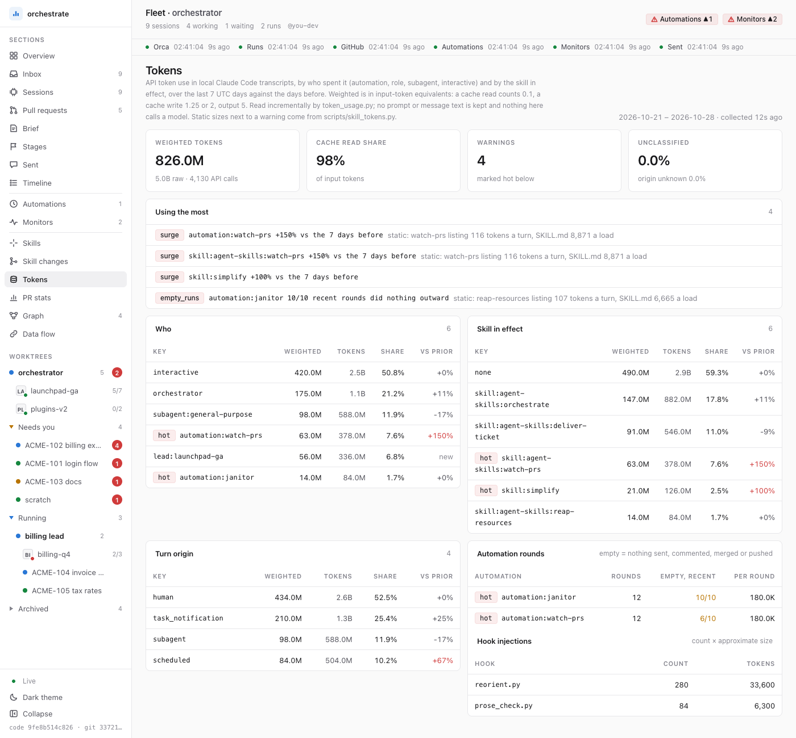

# agent-skills 토큰 사용량 측정

상태: 2026-10-27 승인. 정적 측정(§1)은 `scripts/skill_tokens.py`, 실사용 측정(§2)은 `skills/orchestrate/scripts/token_usage.py`로 구현됐다.

agent-skills가 컨텍스트에 넣는 토큰이 얼마인지, 실제 세션에서 어느 기능이 토큰을 얼마나 쓰는지를 **결정론적 스크립트만으로** 재고 보여 준다. 측정·집계·귀속·경고·대시보드 갱신 어디에도 LLM 호출(서브에이전트, 스킬 실행, `count_tokens` API)이 없다.

## 0. 먼저 잰 숫자 (2026-10-27, 프로토타입)

| 구분 | 값 | 뜻 |
|---|---|---|
| 스킬 목록(항상 로드, 상한) | 40줄, 표시 폭 13,538, 근사 3,681 토큰 | 스킬 목록 예산(컨텍스트 창의 약 1%, 표시 폭으로 셈)을 모든 플러그인과 개인 스킬이 나눠 쓴다. 넘치면 사용 횟수가 적은 스킬부터 description이 빠진다 |
| 가장 긴 목록 줄 | record-progress 583, setup-pc 532, ui-review 478, orchestrate 461, end-session 420 (표시 폭) | 줄이면 토큰도 줄고 목록에서 빠질 위험도 준다 |
| 에이전트 목록(항상 로드) | 4줄, 근사 295 토큰 | |
| SKILL.md 본문 합계(호출 시) | 근사 97,273 토큰 | orchestrate 15,484, watch-prs 8,871, reap-resources 6,665, deliver-ticket 4,806 |
| 본문이 이름을 대는 reference(다 읽으면) | 근사 97,255 토큰(파일마다 한 번) | `orchestrate/references/dashboard.md` 하나가 22,368이고 세 스킬이 가리킨다 |
| 훅 주입(항상) | 평범한 세션에서 0 | 텍스트를 넣는 훅 다섯 개 모두 조건부다(§1.3) |
| 실사용 7일(한 PC, 970개 transcript, 2.05 GB) | 63억 토큰 | cache read 98%, cache 생성 2%, output 0.4% |
| 실사용 7일, 턴 출처별 | 사람 51%, 작업 알림(모니터·백그라운드 작업이 깨운 턴) 24%, 서브에이전트 12%, peer 메시지 10%, 예약 실행 4% | 같은 데이터를 스크립트 한 번(6초)으로 집계 |

토큰 수만 보면 cache read가 거의 전부라 "많이 쓴다"가 왜곡된다. 그래서 실사용 표는 원 토큰과 **비용 가중 토큰**(입력 1 기준: cache read 0.1, 5분 cache 생성 1.25, 1시간 cache 생성 2, output 5)을 함께 낸다. 가중치는 스크립트 상수이고 문서에 근거를 적는다.

## 1. 정적 측정

세션을 띄우지 않고 저장소 파일만 읽는다.

### 1.1 범위

| 분류 | 대상 | 세는 법 |
|---|---|---|
| 항상: 스킬 목록 | 각 `skills/*/SKILL.md` frontmatter | 목록 한 줄 그대로: `- agent-skills:<name>: <description>`. `disable-model-invocation: true`이면 description 없이 이름만 |
| 항상: 에이전트 목록 | `agents/*.md` frontmatter | `- agent-skills:<name>: <description> (Tools: …)`, tools가 없으면 `All tools` |
| 조건부: 훅 주입 | `hooks/hooks.json`의 각 명령 | §1.3 |
| 호출 시 | `SKILL.md` 전체(frontmatter 포함) + 본문이 이름을 대는 reference | 본문의 `[…](references/x.md)` 링크와 백틱 `references/x.md`를 1단계만 따라간다. 다른 스킬의 reference(`interrogate`의 `references/lead-judgment.md`)는 그 이름을 댄 스킬 쪽에 넣고 `cross`로 센다. reference는 한 절만 읽거나 아예 안 읽는 경우가 많아서, 본문과 섞지 않고 "다 읽으면"의 상한으로 따로 낸다 |
| 저장소 안에서만 | `CLAUDE.md`, `AGENTS.md` | 이 저장소에서 작업하는 세션만 읽는다. 플러그인 사용자에게는 0이라 따로 적는다 |

### 1.2 토큰 근사

오프라인 근사가 기본이다. 문자를 여섯 부류로 나눠 계수를 곱한다(`APPROX_PER_CHAR`).

| 부류 | 기본 계수(토큰/문자) |
|---|---|
| ASCII 영숫자 | 0.25 |
| ASCII 문장부호·기호 | 0.5 |
| 공백·줄바꿈 | 0.1 |
| 한글 음절·자모 | 0.9 |
| 그 밖의 CJK(전각) | 1.2 |
| 그 밖의 비ASCII(대시, 화살표 등) | 1.0 |

**정확도.** 이 계수는 보정 전 추정값이다. API 값과의 오차는 아직 재지 못했다(API 키가 없었다). 그래서 지금 숫자는 상대 비교용이다. 어느 파일이 큰지, PR이 얼마나 늘렸는지를 보는 데 쓰고, 절대값을 청구 금액처럼 읽지 않는다. 보정은 키가 있는 사람이 한다.

```bash
ANTHROPIC_API_KEY=… python3 scripts/skill_tokens.py calibrate        # 새 계수와 오차(중앙값·최대, %)를 출력만 한다
```

`calibrate`는 이 체크아웃의 `SKILL.md`·reference·에이전트 파일마다 API 값을 받아 부류별 계수를 최소제곱으로 맞추고, 지금 계수의 오차와 새 계수의 오차를 나란히 출력한다. 계수를 바꾸는 커밋에 그 출력과 "표본 N개, 오차 중앙값 x%, 최대 y%"를 이 절에 적는다.

`--exact`는 명시 플래그일 때만 `count_tokens` API를 부른다(파일·목록 줄마다 한 번, 같은 텍스트는 한 번). 요청마다 붙는 고정 오버헤드는 한 글자짜리 요청으로 재서 뺀다. 키가 없으면 근사로 넘어가지 않고 오류로 끝난다. 키는 환경 변수에서 읽기만 하고 출력·저장하지 않는다. 그 밖의 경로는 어떤 모델도 부르지 않는다.

스킬 목록에는 토큰과 별도로 **표시 폭**(CJK 한 글자 = 2)을 낸다. 목록 예산이 토큰이 아니라 표시 폭으로 잘리기 때문이다. `--listing-budget N`으로 예산을 넣으면 이 플러그인 몫이 몇 %인지 보여 준다. 기본값은 없고(몫을 내지 않음), 실제 예산은 `claude -p … --debug-file`의 "Skill listing over budget" 줄에서 읽어 넣는다. `~/.claude.json`은 읽지 않는다.

### 1.3 훅

훅은 실행하지 않는다(2026-10-27 결정). 정적 측정은 `hooks.json`의 훅마다 이벤트와 "언제 텍스트를 넣는가"만 낸다. 텍스트를 넣는 훅은 모두 조건부이고, 넣는 양은 세션 상태(열린 결정 수, 역할, 프로그램 이름)에 따라 달라서 파일만 보고 정할 수 없기 때문이다. 크기는 §2가 transcript의 훅 첨부에서 `횟수 × 실제 크기`로 잰다.

| 훅 | 이벤트 | 텍스트를 넣는 때 |
|---|---|---|
| `onboard.py` | SessionStart | 설정이 적용되지 않은 프로필에서, 적용하거나 거절할 때까지 |
| `reorient.py` | SessionStart, UserPromptSubmit | 역할(orchestrator·lead)이 선언된 세션의 프롬프트마다, 그리고 세션 시작 |
| `decision.py` | UserPromptSubmit | Orca 터미널에 그 터미널이 등록한 열린 결정이 있을 때 프롬프트마다 |
| `request_log.py` | UserPromptSubmit | 역할 세션의 사람 프롬프트마다 |
| `prose_check.py` | PreToolUse | 커밋·PR·트래커 쓰기의 문장이 write-plainly에 걸릴 때 |
| 나머지 다섯 개 | PreToolUse 등 | 넣지 않는다. 막거나 거부할 때 그 이유만 |

`HOOKS` 표에 없는 훅이 `hooks.json`에 생기면 `unknown`으로 나오고 테스트가 실패한다.

### 1.4 중복

정규화(소문자, 공백 압축, 목록 기호·강조 제거) 뒤 60자 이상 같은 문장이 두 파일 이상에 나오면 보고한다. 문장은 줄 안에서 마침표로 자르므로, 줄바꿈된 문단은 같은 줄끼리 맞춰진다. 비슷한 문단(shingle) 탐지는 넣지 않는다. `save`는 한 곳에만 둘 때 줄어드는 토큰이다. 일부러 같은 글을 여러 곳에 두는 경우도 있다(`orchestrate`의 거부된 행동 문단은 워커 brief에 그대로 붙여야 해서 `test_refusal_copies.py`가 사본을 맞춘다). 중복이라고 바로 줄일 대상은 아니다.

### 1.5 diff

- `--base <git-ref>`: 이 브랜치가 그 ref에서 갈라진 커밋(`git merge-base <ref> HEAD`)을 잰다. ref 끝과 비교하면 main이 앞서간 만큼이 이 브랜치의 변화처럼 섞이기 때문이다. HEAD가 ref를 이미 포함하면 ref 그대로다. `git archive`로 그 커밋의 `skills/`·`agents/`·`hooks/` 등을 임시 디렉터리에 풀어 같은 측정을 하고 차이를 낸다. 체크아웃이나 worktree를 만들지 않고 작업 트리를 건드리지 않는다.
- `--baseline <file.json>`: 이전 `--json` 출력과 비교한다.

### 1.6 사용

```bash
python3 scripts/skill_tokens.py static                       # 표
python3 scripts/skill_tokens.py static --json > base.json    # 기준선
python3 scripts/skill_tokens.py static --base origin/main    # 이 브랜치가 늘린 양(merge-base 기준)
python3 scripts/skill_tokens.py static --listing-budget 30000 # 스킬 목록 예산 중 이 플러그인 몫
```

2026-10-28 이 저장소에서의 출력(일부):

```text
ALWAYS (every turn; an upper bound: over the listing budget, descriptions are dropped)
                                   tokens   width
  skill listing, 40 skills        3,681  13,538
  agent listing, 4 agents          295   1,172
  longest descriptions: record-progress 583, setup-pc 532, ui-review 478, orchestrate 461, end-session 420, ...

ON INVOKE, top 10       SKILL.md   named refs (if all read)   refs from other skills
  orchestrate              15,484     47,308 in  7               1
  watch-prs                 8,871        953 in  1               1
  reap-resources            6,665      5,066 in  2               1
  deliver-ticket            4,806     12,761 in  8               2
  ...
  all 40 skills            97,273     97,255 (each file once)

$ python3 scripts/skill_tokens.py static --base 86b859a --top 3
vs 86b859a: always +140 tokens (+517 width), on invoke +2,490, named refs +271, repo-local +0, duplicates +20
  on invoke     skills-config                       0 ->    1,709  (+1,709)
  reference     skills/orchestrate/references/dashboard.md   21,631 ->   22,368  (+737)
  reference     skills/brief/references/hand-format.md    5,708 ->    5,161  (-547)
```

이 저장소 전체를 재는 데 0.2초가 걸린다.

## 2. 실사용 측정

구현: `skills/orchestrate/scripts/token_usage.py`. CLI는 `python3 scripts/skill_tokens.py usage`(같은 파일의 `main`), 대시보드 서버가 같은 수집을 15분마다 돌린다.

### 2.1 출처와 읽는 법

- 로컬 Claude Code transcript JSONL만 읽는다. 경로는 `$CLAUDE_PROJECTS_DIR`, 없으면 `$CLAUDE_CONFIG_DIR/projects`, 없으면 `~/.claude/projects`이고, 그 아래 `*/*.jsonl`과 `*/*/subagents/*.jsonl`이다. 코드·테스트·문서에 실제 경로를 적지 않는다.
- 읽는 필드: `assistant` 행의 `message.id`, `message.usage`(input, cache 생성 5분·1시간, cache read, output), `timestamp`, `sessionId`, `attributionSkill`, tool_use의 이름과 `Skill`의 스킬 이름, Bash 명령(바깥 행동 판정에만), `user` 행의 `turnOrigin`, 훅 첨부(`hook_success`)의 명령 경로와 `additionalContext` 길이, `subagents/*.meta.json`의 `agentType`.
- **본문은 저장하지도 출력하지도 않는다.** 캐시에 남는 것은 숫자, 귀속 키(자동화·스킬·에이전트 이름, lead slug), 세션 id, 파일 경로의 해시뿐이다. 자동화 식별에 쓰는 첫 프롬프트는 공백을 정규화한 앞 120자의 SHA-1 앞 16자리만 비교한다.
- 같은 `message.id`가 content 블록마다 여러 행으로 반복되므로(표본에서 44%) 파일마다 최근 id 64개를 두고 한 번만 센다.
- **증분 읽기**: 캐시(`<fleet state>/token-usage-cache.json`)에 파일마다 inode, 읽은 byte offset, mtime과 그 세션의 진행 상태(누가, 현재 턴 출처, 현재 스킬)를 둔다. 다음 수집은 offset부터 마지막 완전한 줄까지만 읽는다(쓰는 중인 반 줄은 다음 번에). 크기가 offset보다 작아지거나 inode가 바뀐 파일만 처음부터 다시 읽는다. 결과는 UTC 날짜별 버킷으로 쌓고 120일이 지나면 버린다. 줄 필터(`"usage"`, `"type":"user"`, `hook_success`가 든 줄만 JSON 파싱)를 쓴다.
- 측정(2026-10-28, 한 PC): 남아 있는 transcript 4,035개 첫 수집 30초, 새 줄이 없을 때 다음 수집 0.7초.

### 2.2 귀속

API 호출 하나(`message.id` 하나)를 두 축으로 나눈다. 미분류 비율을 표 머리에 같이 낸다.

**누가(세션 축)**, 위에서부터 처음 맞는 것:

1. 서브에이전트 transcript → `subagent:<agentType>`
2. 자동화 세션: 첫 프롬프트의 해시가 등록된 자동화 프롬프트와 같음 → `automation:<이름>`. 등록 목록은 수집할 때마다 `orca automations list --json`에서 이름과 프롬프트 해시만 읽는다. Orca가 없거나 실패하면 캐시에 남은 직전 목록을 쓴다
3. 역할 세션: `$AGENT_SKILLS_STATE/roles/<session>.json`(reorient가 쓰는 기록) → `orchestrator`, `lead:<slug>`. 역할은 세션 중간에 생기기도 하므로 `interactive`인 세션은 사람 프롬프트마다 다시 본다
4. 나머지 → `interactive`. 첫 프롬프트 전의 호출은 `unclassified`

프롬프트는 `<`로 시작하지 않는 사람 입력, `<pasted_content>`, 슬래시 명령이다. 슬래시 명령은 `<command-name>`과 `<command-args>`로 `/이름 인자`를 다시 만들어 쓴다(본문은 isMeta 행으로 따로 온다). 2026-10-28 실데이터에서 이것을 넣기 전 미분류가 27%, 넣은 뒤 0%였다.

**무엇이(턴 축)**:

- 스킬: 그 응답의 `attributionSkill`, 없으면 같은 턴에서 마지막으로 불린 `Skill` → `skill:<name>`, 둘 다 없으면 `none`
- 턴 출처: `turnOrigin`(`human`, `task_notification` = 모니터·백그라운드 작업·inbox wait가 깨운 턴, `peer`, `scheduled`, `sdk`, `auto_continuation`). 값이 없으면 `<task-notification>`으로 시작하는 턴은 `task_notification`, 서브에이전트 transcript는 `subagent`, 그 밖은 `unknown`

**가중치**: 표의 "weighted"는 입력 토큰 환산이다. cache read 0.1, cache 생성 5분 1.25·1시간 2, output 5(가격표 비율). 98%가 cache read라 원래 토큰 합만 보면 순위가 cache read로 정해진다.

**훅 주입**: 이 플러그인의 훅(`hooks/hooks.json`에 있는 스크립트 이름)이 남긴 `additionalContext`를 근사 토큰으로 바꿔 훅별로 `횟수`와 `합계`를 낸다. 주입된 문구는 이후 턴에서 cache read로 다시 읽히지만 그 몫은 나누지 않는다(세션 축 합계에 이미 들어 있다).

**자동화 회차**: 자동화 세션 하나가 한 회차다. 바깥 행동(Bash의 `orca orchestration send|reply`, `gh pr merge|comment|review|edit|create`, 쓰기 메서드의 `gh api`, `git commit|push`, 이름이 Slack 전송이나 코멘트·이슈·메시지 생성인 도구)이 하나도 없으면 빈 회차다.

### 2.3 가시화

CLI(`--days N`, `--json`, 캐시만 읽는 `--no-collect`). 아래는 대시보드 데모의 지어낸 데이터다.

```text
$ python3 scripts/skill_tokens.py usage
2026-10-22 .. 2026-10-29 (UTC days, end exclusive) · 5.0B tokens, 826.0M weighted (input-equivalent), 4,130 API calls
unclassified: who 0.0%, origin 0.0%

WHO                                  tokens  weighted  share   trend
  interactive                          2.5B    420.0M  50.8%     +0%
  orchestrator                         1.1B    175.0M  21.2%    +11%
  subagent:general-purpose           588.0M     98.0M  11.9%    -17%
  automation:watch-prs               378.0M     63.0M   7.6%   +150%
...
AUTOMATION ROUNDS                  in window  empty (recent)  weighted/round
  automation:janitor                      12     10/10             180.0K
  automation:watch-prs                    12      6/10             180.0K

HOOK INJECTIONS                    count  tokens (approx.)
  reorient.py                        280    33,600
  prose_check.py                      84     6,300

WARNINGS (4)
  surge      automation:watch-prs +150% vs the 7 days before — static: watch-prs listing 116 tokens/turn, SKILL.md 8,871 per load
  empty_runs automation:janitor 10/10 recent rounds did nothing outward — static: reap-resources listing 107 tokens/turn, SKILL.md 6,665 per load
...
```

대시보드(`orch-dash`) Tokens 페이지: 대시보드 서버의 `tokens_loop`가 `tokens.json`이 없거나 15분 지났을 때 수집하고(`ORCH_TOKENS=off`로 끔), 페이지는 `/api/fleet/tokens` JSON만 그린다. 경고 목록("Using the most"), 누가·스킬·턴 출처 표(전 기간 대비, 경고 대상은 `hot`), 자동화 회차, 훅 주입. Automations 페이지의 orch-dash 작업 목록에 "Token usage collect"가 같이 나온다. 데모(`dash.py demo`)는 지어낸 `tokens.json`을 쓰고 실제 transcript를 읽지 않는다.



### 2.4 경고

`interactive`와 `unclassified`, 스킬 `none`에는 경고를 내지 않는다(줄일 기능이 아니다).

| 경고 | 기본 임계 | 설정 키(`~/.claude/agent-skills.json`의 `token_usage`) |
|---|---|---|
| 하루 비중(`daily`) | 어제나 오늘, 키 하나가 그날 가중 합계의 30% 이상이고 가중 50M 이상 | `daily_share`, `daily_min` |
| 급증(`surge`) | 기간 가중 합계가 직전 같은 기간의 1.5배 이상이고 가중 20M 이상 | `surge`, `surge_min` |
| 빈 회차 반복(`empty_runs`) | 자동화의 최근 10회 중 빈 회차가 7회 이상 | `empty_runs`, `empty_window` |

숫자가 아닌 값과 모르는 키는 무시한다. 설정 파일 위치는 `$AGENT_SKILLS_CONFIG`로 바꿀 수 있다. 경고마다 그 기능의 정적 측정(목록 줄 토큰, `SKILL.md` 토큰)을 붙인다. 스킬 키는 그 스킬, 자동화는 프롬프트가 처음 이름을 대는 스킬, `orchestrator`·`lead:*`는 `orchestrate`다.

brief: 주기 보고(`orch brief render --periodic`)에만, `tokens.json`에 경고가 있고 그 보고가 26시간 안에 만들어졌을 때 한 줄이 붙는다. `🔥 토큰 경고 4건: automation:watch-prs +150% vs the 7 days before; … 외 2건 (대시보드 Tokens)`. `board.token_line`이 파일만 읽어 만들고 수집은 하지 않는다.
## 3. 측정기 자체 비용

측정·집계·경고·대시보드 갱신은 모두 결정론적 스크립트다. LLM 호출은 0이다(`--exact`·`calibrate`의 `count_tokens`만 예외이고, 명시 플래그일 때만 돈다).

| 항목 | 컨텍스트 비용 |
|---|---|
| 새 스킬·에이전트 | 없다. CLI는 `scripts/skill_tokens.py` 하나, 실사용 수집은 같은 파일의 `usage` 하위 명령 |
| 새 훅 | 없다. 어떤 훅도 매 턴 이 측정을 돌리거나 결과를 주입하지 않는다 |
| 기존 SKILL.md 변경 | 없다. brief의 경고 한 줄은 스크립트 출력이라 SKILL.md 문장이 필요 없다 |
| 자동화 | 없다. 실사용 수집은 이미 떠 있는 대시보드 서버의 루프에서 돈다 |
| 기존 reference 변경 | 없다. 사용법은 이 문서에만 있다 |

두 PR의 확인: `python3 scripts/skill_tokens.py static --base origin/main`(merge-base와 비교) → `always +0 tokens (+0 width), on invoke +0, named refs +0`.

실행 비용: 15분마다 증분 수집 한 번(새 줄만 파싱, 새 줄이 없으면 1초 안), `orca automations list` 한 번, 정적 측정 한 번(0.2초). 첫 수집만 남은 transcript 전체를 읽는다(§2.1).

## 4. 개선 루프

- `write-skill` §5에 "`static --base origin/main`의 항상 로드 증가분을 보고에 적는다" 한 줄은 후속으로 뺐다(2026-10-27 결정). 스킬 수정이라 write-skill 전 절차가 붙는다.
- `reflect`는 바꾸지 않는다. 경고가 생기면 대시보드와 brief에서 사람이 보고 reflect를 부른다.
- CI 예산 경고는 제안만 한다: `test_skill_tokens.py`에 "스킬 목록 표시 폭 합계 ≤ N"을 하나 두면 description이 늘 때 테스트가 실패한다. N은 오너가 정하면 넣는다.

## 5. 구현 범위

1. **정적**(이 문서와 함께 들어간 PR): `scripts/skill_tokens.py`의 `static`(표·JSON·`--base`·`--baseline`·`--listing-budget`·`--exact`)과 `calibrate`, `scripts/test_skill_tokens.py`.
2. **실사용**: `skills/orchestrate/scripts/token_usage.py`(증분 캐시, 귀속, 경고)와 `usage` 하위 명령, `orch-dash` Tokens 페이지(`dash.py`, `fleet.js`, `flow.py`의 저장소 지도, 데모 데이터), brief 경고 한 줄(`board.token_line`), `test_token_usage.py`(합성 transcript fixture만, 실제 경로·이름 없음).

실제 스킬 축약은 두 PR 모두에 넣지 않는다. 개선 후보는 PR 본문에 적는다.
